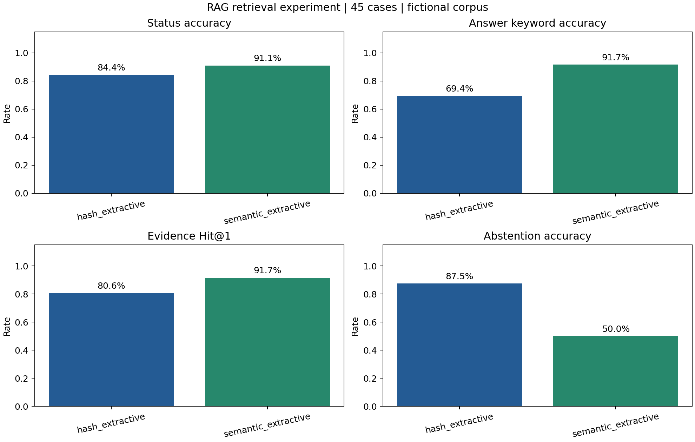

# 课程演示_技术草稿

- Source: `课程演示_技术草稿.pptx`
- Total slides: 13

## Slide 1

领域知识库问答系统

• 语义 Embedding + FAISS + 检索增强生成

• 课程演示技术草稿｜2026-11-03

• 成员姓名、分工与真实模型结果由团队补充

RAG 课程项目｜技术草稿｜1/13

## Slide 2

问题与应用场景

• 基于指定产品文档或校园手册回答领域问题

• 按产品与版本检索，减少知识串用

• 回答带来源；资料不足拒答，敏感业务转人工

RAG 课程项目｜技术草稿｜2/13

## Slide 3

语料与处理

• 自建虚构语料 6 份，原文 1027 字符

• 清洗、标题保留、切分后 31 个片段

• 演示规则不对应真实学校或真实产品；语料可公开复现

RAG 课程项目｜技术草稿｜3/13

## Slide 4

系统架构

• 浏览器 → FastAPI → 会话编排

• 文档清洗 → 分块 → 语义 Embedding → 向量持久化

• 产品/版本过滤 → FAISS Top-K → LLM 或原文回答

• 结果 → 指标与人评 → 失败分析与知识补充

RAG 课程项目｜技术草稿｜4/13

## Slide 5

向量与索引

• 保留 4096 维字符哈希作为基线

• 新增多语言 SentenceTransformer，也可接兼容 Embedding API

• 归一化 float32 向量 + FAISS IndexFlatIP

• 按模型标识隔离；增量建库；删除级联；索引按范围重建

RAG 课程项目｜技术草稿｜5/13

## Slide 6

检索与回答模式

• 页面下拉选择 OpenRouter / Groq / Gemini / 自定义

• auto：FAQ 优先；extractive：返回 Top-1 原文

• llm：严格调用模型，失败不冒充生成成功

• 自备 Key，保存并测试连接；密钥不随代码包提交

RAG 课程项目｜技术草稿｜6/13

## Slide 7

现场演示步骤

• 配置页查看检索/生成状态并补建语义索引

• 查询借阅上限、证明领取地点与版本差异

• 对比未知功能或考试周时间的回答与证据

• 运行 45 题实验，查看失败样本与评分表

RAG 课程项目｜技术草稿｜7/13

## Slide 8

实验设置

• 45 个固定问题：36 可回答、8 无答案、1 转人工

• 同一临时语料库、同一原文模式比较两种检索方案

• 固定阈值：字符 0.16、语义 0.35；未在本测试集调参

• 真实 LLM 方案依赖服务配置；未执行项明确标记

RAG 课程项目｜技术草稿｜8/13

## Slide 9

实际结果：召回改善与拒答退化

RAG 课程项目｜技术草稿｜9/13

## Slide 10

失败案例：有来源仍可能答非所问

• “工作日几点开放”被字符检索匹配到证明办理工作日

• “普通图书借多久”被语义检索匹配到续借 15 天

• “参考书能外借吗”被匹配到普通图书续借操作

• 说明主体、属性、时间条件和否定表达需要专项评测

RAG 课程项目｜技术草稿｜10/13

## Slide 11

失败案例：相似资料不能证明有答案

• 语音转写和价格问题仍可能返回相似但无关片段

• 考试周另行公告，不能套用工作日/周末时间

• 语义方案通过更多题，但无答案拒答准确率更低

• 下一步：证据充分性、重排、独立开发集校准

RAG 课程项目｜技术草稿｜11/13

## Slide 12

质量评估与局限

• 关键词匹配与证据 Hit@K 分开统计

• 忠实度/相关性采用 0–2 分评阅，附依据和覆盖率

• 未进行的人评、真实 LLM 运行不填入假数据

• 小规模自建语料；无独立测试集；无生产性能结论

RAG 课程项目｜技术草稿｜12/13

## Slide 13

提交与成员答辩

• 代码、语料、Prompt、结果与文档可复现打包

• 报告至少 5000 字；每人贡献说明 500–1000 字

• 成员真实分工、互评、服务配置与人评仍需团队填写

• 可选 GraphRAG、微调；当前优先完成模型实验闭环

RAG 课程项目｜技术草稿｜13/13
