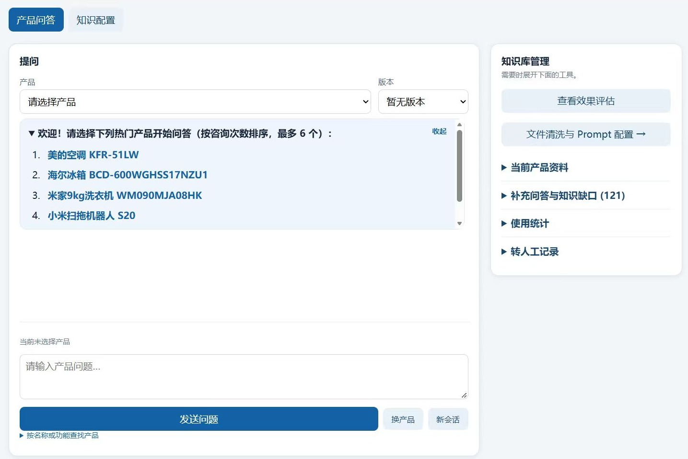
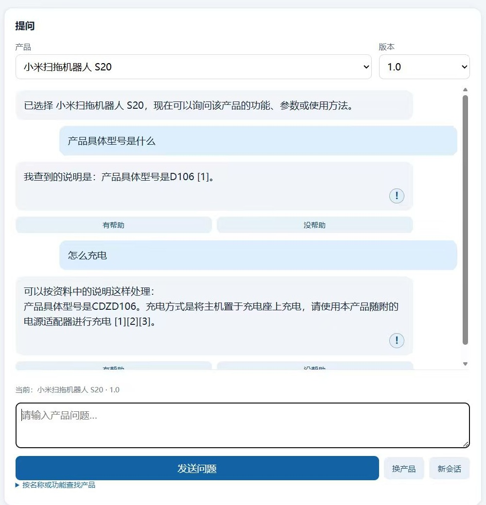

# next_plan_runtime_20261105_211455

- Source: `next_plan_runtime_20261105_211455.pptx`
- Total slides: 5

## Slide 1

系统演示 · 运行与知识配置

产品问答与知识配置已经具备操作界面

产品问答

选择产品和版本，输入问题

回答展示相关资料来源

知识配置

导入说明书，清洗并切分资料

支持补充问答与查看知识缺口

界面截图来自提供的运行记录；本次使用数据库副本进行验证。

## Slide 2

系统演示 · 本次验证

问答可返回依据，退款问题转人工

本机问答验证

产品：小米扫拖机器人 S20 · 1.0

提问：产品具体型号是什么？

结果：D106，附说明书来源

人工处理

提问“我要退款”后生成转人工记录

本次运行：字符检索 + 原文回答

语义检索与大模型 API 尚未验证

左图为提供的历史界面截图；右侧文字为本次接口实测。

## Slide 3

现状诊断 · 2026.11

三个瓶颈，决定了下一步做什么

语料库

测评集

失败分析

5 份说明书 · 7.1 万字

158 题 · 95% CI ±6.4pp

12 条案例 · 已修 4 条

• 平均 34 字/片段，语义模型缺上下文

• 表格拍平丢失行主语：4 条记录都叫

「最大洗涤容量」

• 多型号并排：总容积 600/601/602 三个值

• 空调 Hit@1 仅 56.6%（其余 88~100%）

• 每产品题量不均：7 ~ 56 题

• 缺同义改写题，鲁棒性未覆盖

• 3 条畸形问句（如「器：BLJ是多少」）

• 单模型，无法区分检索问题与模型能力

• 只有点估计，无显著性检验

• 根因高度收敛：5 条来自表格拍平

• 拒答漏判已修：40% → 100%

• 知识库污染 1 条（编造 FAQ）

• 8 条待修，缺统一记录模板

• 样本量小，未覆盖多轮场景

三者的关系：语料决定上限，测评集决定能否看出问题，失败分析决定改得对不对 —— 顺序不能颠倒。

## Slide 4

行动计划

三件事，逐条对应上面的瓶颈

改善语料库

扩充测评集

失败案例分析

01

02

03

① 表格拍平时并入行主语与型号

最大洗涤容量:6 kg

→ 智能清洗程序的最大洗涤容量为 6 kg

② 切片从「一行一条」改为段落级 200~300 字

③ 扩到 10 份说明书，多型号按 version 拆分

④ 入库前统一简繁，保留 `#` 标题层级

① 158 → 300 题（CI 从 ±6.4pp 收窄到 ±4.5pp）

② 合并 10 条同义改写题（草稿已出并校验）

③ 每产品题量均衡到 50±5 题

④ 新增 20 条多轮追问与 10 条跨型号辨析

⑤ 生成后加通顺性过滤，剔除畸形问句

⑥ A/B 对照补配对检验（McNemar），报 p 值

① 建立统一模板：现象 / 证据 / 根因定位 /

影响 / 修复 / 复测结果

② 样本从 12 条扩到 30 条，覆盖多轮与拒答

③ 按「改哪里」分类，不做「错在哪」分类

④ 每条必须定位到代码行号 / 语料片段 /

知识库记录，禁止停在「模型能力不足」

⑤ 已修项必须用同一批样本复跑验证

预期收益

预期收益

预期收益

消除 5 条失败案例

空调 Hit@1 56.6% → 80%+

语义检索才具备可用性

结论从「方向」变「可判定」

补齐鲁棒性一格

多轮与辨析场景可测

形成可复用的失败模式清单

支撑「为什么不用语义检索」

答辩时可直接举证据

## Slide 5

路线图

先修语料，再补测评，最后收口分析

语料重清洗

第 1 周

2 天

表格并回行主语、按型号拆文档、段落级切片

重建索引并复测

第 1 周

1 天

重新入库 → reindex → 跑 158 题对照

扩充测评集至 300 题

第 2 周

3 天

同义改写 + 多轮 + 辨析 + 通顺性过滤

失败案例扩到 30 条

第 2 周

2 天

统一模板补写，已修项全部复测

报告与答辩材料

第 3 周

3 天

数据更新、PPT、贡献说明、互评

预期指标变化（基于已测数据外推，实施后以实测为准）

空调 Hit@1

语义检索 Hit@1

测评集置信区间

失败案例（已定位）

拒答正确率

56.6%

48.6%

±6.4pp

12 条

40%→100%

→ 80%+

→ ≥79%

→ ±4.5pp

→ 30 条

→ 保持
